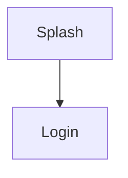

# <App name> — UI Map

- **Repo:** <url>  ·  **Branch / commit:** <branch> @ <short-sha>  ·  **Read on:** <YYYY-MM-DD>
- **Stack:** <e.g. Android, Kotlin, Jetpack Compose + Navigation Compose>
- **Primary users:** <who uses this app>

## 1. Navigation map

Entry points: launcher <screen>; bottom nav <tabs>; deep links <list>.

## 2. Screen inventory
| Area | Screen | Purpose | Reached from | Leads to | Source |
|---|---|---|---|---|---|

## 3. Design tokens
### Colour
| Token | Light | Dark | Used for | Source |
|---|---|---|---|---|
### Typography
| Style | Font | Size / weight | Used for |
|---|---|---|---|
### Spacing, shape, elevation
| Token | Value | Used for |
|---|---|---|

## 4. Components
| Component | Variants | States | Used on | Source |
|---|---|---|---|---|

## 5. Screen states (key screens)
### <Screen>
- Loading: …  ·  Empty: …  ·  Error: …  ·  Success: …  ·  Blocked/disabled: …

## 6. User-visible copy (key flows)
### <Screen>
- <string key> — "<text>"

## 7. Config-driven UI
- <what changes on screen> — controlled by <flag or remote config, by name only>

## 8. Open items
- TBD: …
