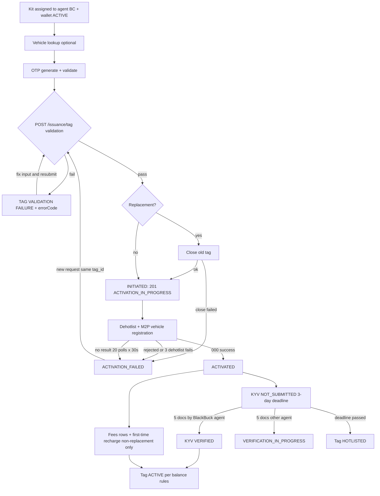

# Domain: TZF FASTag issuance + PPI wallet (designer reference)

**Source commits:** `tzf-fastag` @ 2492cfd, `ppi-wallet` @ 04ef116 (repos under `repos/`).
**Last verified 2026-10-15.**

## 0. Reading guide

- Both services are **backend-for-backend**. Boss and BB Pro do not call them directly; the BlackBuck backend does (headers `x-tenant-identifier` = BC/agent id, `x-agent-identifier`). Design screens against the **states, fields, limits and messages** below, not against raw endpoints. Screen-to-endpoint mapping is NOT in these repos.
- Confidence tags: unmarked = verified in code. **(doc-only)** = only in docs/comments. **(unverified)** = inferred or not found in code.
- Paths are repo-relative and prefixed with the repo name, e.g. `tzf-fastag:service/UserToggleService.java` (under `src/main/java/com/zinka/tzf_fastag/`) and `ppi-wallet:service/RequestValidator.java` (under `src/main/java/com/zinka/ppi_wallet/`; KYC code is under `.../com/zinka/kyc/`).
- Money is INR. Messages in section 5 are the literal server strings; the app may re-word them.
- Security note for maintainers: `ppi-wallet:src/main/resources/application-prod.yml` contains committed secret-like values. None are reproduced here. Do not add any to design files.

## 1. Glossary

| Term | Meaning |
|---|---|
| **TZF** | TZF Logistics Solutions; BlackBuck's FASTag issuer entity. "TZF FASTag" = a NETC FASTag issued via vendor **M2P** (only enabler: `tzf-fastag:enums/NETCEnabler.java`). |
| **NETC / FASTag** | National Electronic Toll Collection tag on a vehicle; its standing is held in an "exception list". |
| **Issuance** | Activating a physical tag (kit) against a vehicle and wallet. Types: `VRN_ISSUANCE` (registration number known), `CHASSIS_ISSUANCE` (chassis only; `reg_number` holds the chassis), `VRN_UPDATED` (chassis tag later given a VRN). |
| **Replacement issuance** | New tag replaces an existing TZF tag on the vehicle; old tag is closed first; skips fees, first recharge, threshold. |
| **Hotlist / dehotlist** | Hotlist = tag blocked at toll plazas. Dehotlist = unblocked. User-facing: "FASTag toggle" OFF = hotlist, ON = dehotlist. |
| **KYV** | Know Your Vehicle: photos/documents of the truck, tag and RC. Not KYC. |
| **KYC (MIN / MAX)** | Customer identity level on the wallet. MIN = default small-limit. MAX = full KYC, higher cap. |
| **PPI wallet** | Prepaid wallet (`wallet_id`, 13 digits) that every FASTag debits for tolls. One ACTIVE wallet per customer (phone + PAN). |
| **BC** | BlackBuck customer/agent id (`bc_id`); also the credit pool ("BC recharge"). |
| **BBPS** | Bharat Bill Payment System; wallet recharge through third-party bill-pay apps (via Setu). |
| **UPI recharge** | Pay to the tag/wallet VPA; M2P calls hold then credit. Display name "FASTAG RECHARGE". |
| **E-mandate / auto-recharge** | UPI AutoPay mandate that tops the wallet up to a threshold. Owned by tzf-fastag (`arm_mandate`), executed via ppi-wallet. |
| **E-notice** | Vehicle-level NETC notice flag; also tag status E_NOTICE. |
| **VC4** | Vehicle class (car/jeep). KYV-exempt and can never be LOW_BALANCE. |
| **FO / TSL / CAF / PEP / DKYC / CP** | FO = fleet owner (customer). TSL = BlackBuck/TZF agent who verifies (selfie, signature, review). CAF = Customer Application Form PDF (application number = `kyc.transaction_id`). PEP = politically exposed person screening (Zigram). DKYC = digital KYC. CP = channel partner. |
| **Paper KYC** | Agent/portal-assisted KYC with uploaded paper docs and a signed CAF. |
| **Partner issuance** | External partners issue TZF tags via BlackBuck APIs. Code shows NO separate partner path; see section 6. |

## 2. Product areas in user terms

1. **Get a FASTag** (issuance): pick a kit, verify owner by OTP, submit vehicle, wait for activation (async), then complete KYV.
2. **Vehicle documents (KYV)**: upload truck/tag/RC photos within 3 days or the tag is blocked.
3. **FASTag ON/OFF toggle and tag status**: owner blocks/unblocks the tag; status badge explains why a tag is not working.
4. **Wallet balance and recharge**: BC recharge, UPI, BBPS, auto-recharge mandate; balance and monthly limits depend on KYC level.
5. **Auto-recharge (mandate)**: set up, set threshold, automatic top-ups with retries.
6. **Full KYC upgrade**: document upload, customer OTP, agent/TSL steps, ops review, approval or rejection with reasons; raises wallet cap.
7. **Tag closure / replacement / chassis-to-VRN update**.
8. **Notifications**: SMS only (swipe, recharge, chargeback, closure, KYC, OTP, balance). No push/WhatsApp in these repos.
9. **Ops/back-office** (not mobile): tech-support tools, KYC review portal, Paper KYC portal, escrow transfers.

## 3. TZF issuance journey, end to end

Actors: BlackBuck agent/field app or ops (acting for the fleet owner), vehicle owner (OTP + KYV photos), tzf-fastag, M2P (vendor), ppi-wallet. Source: `tzf-fastag:service/issuance/TagIssuanceHandler.java`, `TagIssuanceValidator.java`, `scheduler/TagIssuanceScheduler.java`.

1. **Pre-requisites.** Kit exists in inventory as UNASSIGNED and is assigned to the agent's `bc_id`; wallet is ACTIVE in ppi-wallet (created earlier, see 3b); a product plan exists (first-time recharge, security deposit, issuance fee).
2. **Vehicle lookup (optional).** `GET /vehicle/info` returns Vahan data (axles, GVW, permits, maker, fuel...). Empty 404 if M2P has no vehicle.
3. **OTP.** `POST /otp/generate` -> "OTP sent successfully" + `otp_request_id`. User enters 6-digit OTP -> `POST /otp/validate`. Skipped if request's `otp_request_id` equals the wallet's own, and always skipped for `/issuance/tag/manual`. Whitelisted test phones get a fixed OTP, no SMS.
4. **Submit.** `POST /issuance/tag`. Validation runs in order (inventory, previous txns, live M2P tag status, wallet/OTP, product). Rejections are HTTP 200 with `status "TAG VALIDATION FAILURE"` + `errorCode`/`errorMessage` (table in section 5.2).
5. **Replacement pre-close.** If `is_replacement` and an active TZF tag exists, it is closed first. If close fails: message "Close tag failed, cannot activate replacement FASTag" and an ACTIVATION_FAILED row.
6. **Activation kicked off (async).** Row = INITIATED. Response: status `ACTIVATION_IN_PROGRESS`, code `201`, "Tag activation is in progress. Dehotlist operation is being processed." **Client must poll.**
7. **Background activation.** Dehotlist event, then M2P vehicle registration. Permit rule: national permit `T` with past expiry is sent as `F`; missing expiry defaults to 10 years.
8. **Poll.** `POST /issuance/tag/status {wallet_id, tag_id}` -> parallel arrays of status / expiry (MM/yyyy) / error code / message. Re-submitting the same issuance self-heals if M2P already shows the tag active (returns SUCCESS 000). A 30 s cron also reconciles.
9. **On ACTIVATED.** Old tag on the vehicle -> DEACTIVATION_IN_PROGRESS; inventory ASSIGNED; KYV record NOT_SUBMITTED with **3-day deadline**; tag status ACTIVE. Non-replacement only: wallet threshold INR 200 created if absent, fee rows (security deposit, issuance fee; zero amounts skipped), first-time recharge order from the product plan.
10. **KYV.** Upload 5 documents (section 4.5). Missed deadline -> nightly job hotlists the tag (VC4 exempt). BlackBuck-agent upload of 5 docs auto-verifies, tag re-evaluated.
11. **Ongoing.** Tag status follows wallet balance and rules (section 4.3).

### 3b. Upstream: wallet + KYC prerequisites (ppi-wallet)
`POST /wallet-ext/dedupe` (phone/PAN) -> `otp-generate` -> `create` (PAN verified with name+DOB; OTP validated) -> wallet ACTIVE, balance 0, MIN KYC. Full KYC upgrade is optional and independent (section 7).

### Where it stalls or fails (design these states)
| # | Stall/fail | What happens | User-visible |
|---|---|---|---|
| a | Validation rejection (step 4) | Immediate error code + message | Inline error; section 5.2 |
| b | Activation stuck | ACTIVATION_IN_PROGRESS up to ~10 min (20 retries x 30 s), then ACTIVATION_FAILED with `error_code`, `error_message` (max 255 chars) | Spinner/pending, then failure with vendor message |
| c | Pre-activation dehotlist fails after 3 retries | ACTIVATION_FAILED; tag re-hotlisted | Failure |
| d | Replacement pre-close fails | ACTIVATION_FAILED row; status shown as ACTIVATION_IN_PROGRESS in the response | Failure message above |
| e | First-time recharge FAILURE/PENDING after activation | Tag ACTIVE but wallet may be empty; balance rule soon makes it HOTLISTED/LOW_BALANCE | Active tag that quickly shows low balance/blocked |
| f | KYV missed | Tag HOTLISTED at 00:01 IST after deadline | Blocked tag, reason "KYV not completed" |
| g | E-notice | Blocks issuance only if kill switch on (prod = off) | Error TAG_E_NOTICE if on |

Retry: a fresh `POST /issuance/tag` for the same `tag_id` is allowed after ACTIVATION_FAILED (validator only blocks INITIATED / ACTIVATION_IN_PROGRESS / ACTIVATED). There is no explicit retry state.

## 4. State machines

### 4.1 IssuanceStatus (`tzf-fastag:enums/IssuanceStatus.java`, table `issuance_fastag`)
| Value | Meaning to user | Transitions in | Trigger |
|---|---|---|---|
| INITIATED | Request accepted | new row | POST /issuance/tag passed validation |
| ACTIVATION_IN_PROGRESS | "Activating..." (poll) | INITIATED | M2P returns in-progress |
| ACTIVATED | Tag live | INITIATED / IN_PROGRESS | M2P success (000/000 or 000/240), or poll finds tag NETC_NOTEXCEPTION (30 s cron or repeat call) |
| ACTIVATION_FAILED | Failed, shows error_code/message | INITIATED / IN_PROGRESS | M2P rejects (also hotlists tag); dehotlist retries (3) exhausted; scheduler hit 20 retries; no pending record; replacement pre-close failed |
| DEACTIVATION_IN_PROGRESS | Old tag superseded | ACTIVATED | newer tag for same vehicle activated |
| DEACTIVATED | Closed | ACTIVATED | `/techsupport/tag/close`, `/tag/force-close`, or M2P force-close callback |

### 4.2 IssuanceRequestType
`VRN_ISSUANCE` -> n/a. `CHASSIS_ISSUANCE` -> `VRN_UPDATED` via `PUT /chassis-vrn/update-vrn` or `/techsupport/tag/update`.

### 4.3 TagStatus (`enums/TagStatus.java`, table `fastag_status`) = NETC exception standing
| Value (code) | M2P string | Meaning to user |
|---|---|---|
| ACTIVE (00) | NETC_NOTEXCEPTION | Works at toll plazas |
| HOTLISTED (01) | NETC_HOTLIST | Blocked: zero/negative balance, KYV overdue, user toggle OFF, BC/issuer rule |
| NETC_EXCEPTION (02), NETC_INVALID_CARRIAGE (04) | n/a | Declared; no flow seen setting them (unverified) |
| LOW_BALANCE (03) | NETC_LOWBALANCE | Works but below threshold (default INR 200); not for VC4 |
| BLACKLIST (05) | NETC_BLACKLIST | Cannot be unblocked by user |
| CLOSED (06) | NETC_CLOSED_OR_REPLACED | Tag closed/replaced |
| E_NOTICE (07) | `E_NOTICE` (no NETC_ prefix) | Read-only; never sent outbound |

**Single-badge priority (lowest number wins), `service/tagOperation/rule/TagStatusPriority.java`:**
`BLACKLIST(1) > HOTLISTED(2) > E_NOTICE(3) > LOW_BALANCE(4) > CLOSED(5) > ACTIVE(6)`. Comma-separated M2P statuses resolve by this order.

**Calculated status** (only for ACTIVATED tags; all rules evaluated, highest priority wins; `reasons[] {rule_name, status, reason}` returned for "why is my tag blocked" UI):
| Rule | Result | Condition |
|---|---|---|
| BalanceRule | HOTLISTED | balance <= 0 ("Balance X is zero or negative") |
| BalanceRule | LOW_BALANCE | 0 < balance < wallet threshold (default INR 200), vehicle class not VC4 |
| KyvRule | HOTLISTED | KYV not VERIFIED and deadline passed ("KYV not completed and submission deadline exceeded"); VC4 exempt |
| BCOpsRule / IssuerOpsRule | rule's `status_to_apply` | active `TagControlRule` with source BC / ISSUER |
| UserToggleRule | HOTLISTED | active `ToggleControlRule` (user turned toggle OFF) |

Balance events (`FastagStateService`, after each wallet debit/credit): closing >= threshold -> ACTIVE; 0 <= closing < threshold -> LOW_BALANCE; closing < 0 -> HOTLIST; a higher-priority rule overrides. Operations enum: ACTIVE, HOTLIST, DEHOTLIST, LOW_BALANCE, BLACKLIST, CLOSED, REMOVE_CLOSED, DEHOTLIST_AND_LOW_BALANCE. Full tag lifecycle is partly inferred (section 10).

### 4.4 Tag-operation attempt (`FastagStatusManagement.TxnStatus`, poll `GET /tag/status`)
| Value | Meaning | Transitions | Trigger |
|---|---|---|---|
| IN_PROGRESS | "Tag operation to X is in progress" | -> SUCCESS / FAILURE / VALIDATION_FAILED | vendor call result |
| SUCCESS | "Tag status updated to X" | terminal | M2P ok |
| FAILURE | "Tag operation to X failed. <comment>" | terminal after 3 retries (prod `manage.tag.operation.max-retries`) | cron every 15 min republishes failed ops from last 24 h |
| VALIDATION_FAILED | "Validation failed. <comment>" | terminal | rule/validation |
M2P timeout/errCode 157/circuit-breaker triggers an internal reconcile (TZF-558); shows only as comment text.

### 4.5 KYV
| KyvOverallStatus | Meaning | Transition / trigger |
|---|---|---|
| NOT_SUBMITTED | Docs due; deadline = activation + 3 days (`kyv_submission_grace_period`) | created on ACTIVATED |
| VERIFICATION_IN_PROGRESS | "Under review"; further upload blocked | uploaded doc count == 5 (`KYV_MAX_IMAGE_COUNT`) and uploader not BlackBuck |
| VERIFIED | Done; expiry = verify time + `kyvExpiryPeriod` years | immediate when BlackBuck agent uploaded 5 docs; non-BlackBuck review path is outside these repos (unverified) |
| REJECTED | Re-upload allowed | set outside visible code (unverified) |
Doc status (`KyvDocumentStatus`): UNDER_REVIEW (on upload), VERIFIED, REJECTED. Doc types (7): TRUCK_FRONT_IMAGE, TRUCK_SIDE_IMAGE, FASTAG_IMAGE, RC_FRONT, RC_BACK, CHASSIS_INVOICE, CHASSIS_INSURANCE. Required set per issuance type is NOT enforced in code (unverified; flag to PM). Daily 00:01 IST job hotlists NOT_SUBMITTED/REJECTED past deadline (`is_notified` set; no reminder sent from these repos).

### 4.6 Wallet recharge / fee statuses (tzf-fastag)
`RechargeStatus` INITIATED / PENDING / SUCCESS / FAILURE (first-time recharge; status-check cron every 30 min). `FundTransferStatus` INITIATED, SUCCESS, FAILURE, PENDING, CLIENT_ERROR, TECHNICAL_FAILURE, STATUS_CHECK_TECHNICAL_FAILURE (fee rows; actual debit client code is commented out in `service/ppiWallet/PpiWalletClient.java`, so whether deposit/fee debits execute here is unverified).

### 4.7 Mandate (auto-recharge)
| Enum | Values | Notes |
|---|---|---|
| `ArmMandate.MandateStatus` | INITIATED, CONFIRMED, PAUSED, REVOKED, REJECTED, FAILED | set from `enachTokenStatus` events (`MandateServiceImpl.processEmandateStatusEvent`). INITIATED or CONFIRMED blocks a new mandate. Threshold update needs CONFIRMED. |
| `MandatePresentation.PresentationStatus` | INITIATED, SUCCESS, FAILED, REFUND_INITIATED, REFUNDED, REFUND_FAILED | only INITIATED -> SUCCESS/FAILED driven here; refund states set elsewhere (unverified) |
| ppi-wallet execution status | SUCCESS / FAILED / PENDING / NOT_FOUND | `GET /mandate/execution_status` |

### 4.8 Wallet (`ppi-wallet:entity/Wallet.java`)
Values: ACTIVE, SUSPENDED, INACTIVE, FROZEN, DORMANT, CLOSED, CLOSURE_IN_PROGRESS, EXPIRED. Code only creates ACTIVE (balance 0); no path found that sets the others (unverified). Operations need ACTIVE else "Wallet is not in a valid state for this operation". Channel mapping: UPI credit -> code ZY; UPI handle check -> ZH; BBPS FROZEN -> "Wallet is dormant. Contact issuer bank to recharge"; BBPS other non-ACTIVE -> "Wallet is not in active state".

### 4.9 Transaction (`TransactionRequest.Status`)
| Value | Meaning | Transition |
|---|---|---|
| CREATED | request logged | -> PENDING (hold placed) or direct SUCCESS/FAILURE |
| PENDING | credit hold (UPI/BBPS) | -> SUCCESS / FAILURE; holds expire: 60 s check at credit time, Quartz fails UPI/BBPS holds after 10 min |
| SUCCESS / FAILURE | terminal | completing requires PENDING/CREATED else "Cannot update transaction to SUCCESS from X state" |
Recharge API `status` = SUCCESS or FAILED (+`error_reason`); status-check returns uppercase enum text. Duplicate `client_txn_id` -> "Transaction already processed"; duplicate UTR -> DUPLICATE_UTR_FOUND. Sources: BC, NETC, UPI, BBPS, OPS_PORTAL, EMANDATE, EMANDATE_RECURRING, REFUND. Toll ledger (tzf-fastag `TzfTransaction`): entry DEBIT/CREDIT; status SUCCESS/FAILED/VERIFICATION_FAILED/INITIATED; categories incl. NETC_CORPORATE_DEBIT, CREDIT_UPI, CREDIT_BBPS, CREDIT_BC, CREDIT_CHARGEBACK, CREDIT_FIRST_TIME_RECHARGE, CREDIT_EMANDATE(_RECURRING), DEBIT_ADJUSTMENT, CREDIT_ADJUSTMENT, ANNUAL_PASS_RECHARGE, NON_TOLL_TRANSACTION, DEBIT_BC.

### 4.10 UPI recharge (two-phase)
handle-details (is VPA a valid FASTag wallet) -> credit-hold (PENDING) -> credit (SUCCESS, closing balance); `direct/credit` is one step. All return HTTP 200 with M2P codes: **00** success; **ZH** invalid VPA; **ZE** invalid amount/duplicate/validation (hold); **UB** internal/expired; **XE** invalid amount; **B3** not permitted/duplicate/not pending; **PS** max balance or credit limit exceeded; **ZY** wallet not active; **XI** wallet/txn not found; **B6** hold vs credit mismatch (amount, wallet, VPA case-insensitive); **DF** duplicate UTR. (M2P enum also lists UP, YI, YF, ZI; where each is produced is unverified.)

### 4.11 BBPS
Bill fetch -> bill (valid 10 min) -> payment ack (`/bbps/bills/fetchReceipt`) -> PENDING polled every minute against Setu until success/failed (`BillStatusUpdateEvent`). `bill_fetch_status` AVAILABLE. Error messages in section 5.5.

### 4.12 Customer KYC level (MIN vs MAX)
| State | Trigger |
|---|---|
| New wallet: `min_kyc_status` ACTIVE, `kyc_type` MIN | wallet create |
| Full KYC started (any non-terminal incl. CREATED): `max_kyc_status` PENDING, type MIN | KYC created |
| APPROVED: `max_kyc_status` ACTIVE, type MAX (needs min KYC ACTIVE else INVALID_KYC_STATUS) | approval |
| REJECTED: `max_kyc_status` REJECTED, type MIN | rejection (also when rejecting an already-APPROVED KYC, TZF-677) |
Status values: min ACTIVE/EXPIRED; max ACTIVE/EXPIRED/REJECTED/PENDING. Personal details are not editable for MAX ("Cannot update personal details for MAX KYC customer").

| Limit (`ppi-wallet:service/RequestValidator.java`) | MIN | MAX |
|---|---|---|
| Max wallet balance | INR 10,000 | INR 200,000 |
| Monthly credit (credits + holds) | INR 10,000 | not enforced (validator returns early; the 200000 constant is unused for monthly caps) |
| Monthly debit | INR 10,000 | not enforced |
The balance cap check runs before the MAX early-return, so it applies to both.

### 4.13 KYC application (`ppi-wallet:kyc/enums/*`, `kyc/entity/Kyc.java`)
**KycStatus (external):** CREATED, FO_ACKNOWLEDGED, TSL_ACKNOWLEDGED, PEP_VERIFICATION_PENDING, PORTAL_VERIFICATION_PENDING, APPROVED, REJECTED.
Derivation (non-paper): blacklisted -> REJECTED; FO docs STARTED/UPLOADING/UPLOADED -> CREATED; FO ACKNOWLEDGED/TSL_REVIEWED + TSL ACKNOWLEDGED -> TSL_ACKNOWLEDGED, TSL REJECTED -> REJECTED, else FO_ACKNOWLEDGED; FO APPROVED + TSL APPROVED -> PEP_VERIFICATION_PENDING (PEP pending) or APPROVED (NOT_BLACKLISTED). Paper KYC stores status directly: CREATED -> PORTAL_VERIFICATION_PENDING -> APPROVED.
| Vocabulary | Values |
|---|---|
| Portal application status | INITIATED, UPLOAD_PENDING, UNDER_REVIEW, TSL_UPLOAD_PENDING, APPROVED, REJECTED, PORTAL_VERIFICATION_PENDING; tabs: In Progress, Approved, Rejected |
| Channel-partner `CpKycStatus` | PENDING (CREATED), IN_PROGRESS (FO/TSL ack, PEP, portal pending), COMPLETED (APPROVED), FAILED (REJECTED); AGENT_SELFIE_PENDING/REJECTED declared, never produced |
| CP document status | PENDING, UPLOADED, VERIFYING, APPROVED, REJECTED |
| CP ack per file | COMPLETED, IN_PROGRESS, FAILED, NOT_UPLOADED |
| `DocumentStatus` | CREATED -> UPLOADED -> ACKNOWLEDGED -> TSL_REVIEWED -> VERIFIED; or REJECTED; DELETED. Poll API simplifies to PENDING / UPLOADED / VERIFIED / REJECTED per group (ID_PROOF, ADDRESS_PROOF, CUSTOMER_SELFIE, TSL_SELFIE) + `submit_allowed` |
| FoDocStatus | STARTED -> UPLOADING -> UPLOADED -> ACKNOWLEDGED -> (TSL_REVIEWED) -> APPROVED / REJECTED; REJECTED -> UPLOADING/STARTED/APPROVED; APPROVED -> REJECTED (ops reject, TZF-677). Illegal = INVALID_KYC_TRANSITION |
| TslDocStatus | STARTED -> UPLOADING -> UPLOADED -> ACKNOWLEDGED -> APPROVED / REJECTED |
| TSL review / signature | PENDING / APPROVED / REJECTED; signature INITIATED, CANCELLED, UPLOADED, ACKNOWLEDGED |
| Task status | UPLOAD_PENDING, CREATED, PENDING, IN_PROGRESS, COMPLETED, REJECTED, DELETED; steps INITIATED, DOC_TYPE_VERIFIED, SEEDING_VERIFIED, OCR_VERIFIED, FACE_MATCH_VERIFIED, MOVED_TO_MANUAL |
| Blacklist (`UserBlacklistDetail`) | BLACKLISTED / NOT_BLACKLISTED / PENDING (screening timeout); BLACKLISTED can never do KYC |
| KYC modes | NORMAL, DKYC_OTP, EKYC_BIOMETRIC, OFFLINE_KYC, ONLINE_KYC, DIGILOCKER, PAPER_KYC |
Portal steps: "Customer Verification", "TSL Verification", "TSL Review".

### 4.14 Other
- **E-notice:** vehicle flag `has_active_e_notice` + `notice_details {enotice_no, enotice_status, type, desc, status_desc, crtn_ts}`. Issuance gated by `app.issuance.block-on-e-notice` (prod false; dev/stress true; static, needs restart). Per-tag status "I" does not block; "A"/null/blank blocks.
- **OTP:** GENERATED -> VALIDATED (`OtpTransaction`, source FASTAG_ISSUANCE).
- **Inventory:** UNASSIGNED, ASSIGNED, LOST, DAMAGED, DEACTIVATED.
- **Bank transfer (back office):** CREATED, IN_PROGRESS, AWAITING_BANK_RESPONSE, SUCCESS, FAILURE, PERMANENT_FAILURE; escrow bill CREATED, PROCESSING, SUCCESS, FAILED. Not user-facing.
- **Missed-call balance SMS (`KnowlarityCallbackEvent`):** PENDING / SMS_SENT / FAILED.

## 5. Exact user-facing messages

Strings are literal server copy (some contain an em dash). `<x>` = placeholder.

### 5.1 FASTag toggle (`POST /tag/user-toggle`, `tzf-fastag:service/UserToggleService.java`)
Request `{tag_id, truck_no, operation: HOTLIST|DEHOTLIST}`; response `{status, tag_id, final_status, message, reasons[]}`. Toggle OFF = HOTLIST, ON = DEHOTLIST.
| Outcome | Condition | `message` | UI treatment |
|---|---|---|---|
| SUCCESS | already hotlisted | "Tag is already in the desired state" | toggle OFF, no vendor call |
| SUCCESS | hotlist/dehotlist done | "Tag ... successfully", `final_status` ACTIVE for ON | toggle reflects result |
| FAILURE | OFF blocked by higher-priority rule (blacklisted) | "Cannot hotlist tag — blocked by: <rule>" + reasons | toggle stays ON; USER rule reverted |
| FAILURE | M2P error on OFF | "Failed to hotlist tag at M2P" | retry |
| FAILURE | ON but tag blacklisted | "Tag is blacklisted" | cannot enable |
| **BLOCKED** | ON accepted but still HOTLISTED/LOW_BALANCE (low balance, KYV overdue, BC/issuer rule) | "FASTag toggle is ON but tag is still hotlisted due to: <rule name>" + reasons[] | toggle shows ON **with a warning banner listing reasons** |
| FAILURE | ON but status CLOSED etc. | "Cannot activate tag — current status: <status>" | |
| FAILURE | M2P error on ON | "Failed to dehotlist tag at M2P" | retry |
Input errors (HTTP 400): "Truck number is required"; "Invalid operation: <x>. Expected HOTLIST or DEHOTLIST". Toggle OFF persists across recharge. LOW_BALANCE target for VC4 is rejected with literal "CAR's status cannot be moved to Tag STATUS".
Rule names in `reasons[]`: BalanceRule, KyvRule, BCOpsRule, IssuerOpsRule, UserToggleRule. Refresh endpoint messages: "FASTag <id> is not activated - cannot refresh status", "Tag status already up to date. No refresh needed."
Truck-status errors: "truck_no cannot be null or empty"; "No vehicle found for truck_no: <x>"; "No active tag found for truck_no: <x>"; "No fastag status found for tagId: <x>".

### 5.2 Issuance error codes (`TagIssuanceValidator`, `error/ErrorCode.java`)
Returned as HTTP 200 body `{status "TAG VALIDATION FAILURE", code, payload{errorCode, errorMessage}}`.
| errorCode | Code | Message |
|---|---|---|
| INVENTORY_NOT_AVAILABLE | 422 | Tag is not available in our inventory. |
| INVALID_TAG_INVENTORY | 400 | Tag is not unassigned. |
| TAG_NOT_ASSIGNED_TO_AGENT | 403 | Tag is not assigned to requesting agent. |
| TAG_ACTIVATION_IN_PROGRESS | 409 | Given tagId is in the process of Activation. |
| TAG_ALREADY_ACTIVATED | 409 | Given tagId is already Activated. |
| VEHICLE_TAG_DETAILS_NOT_FOUND | 404 | Vehicle tag details not found. |
| EXISTING_ACTIVE_TAG | 409 | Another active tag exists for this vehicle. / (replacement) Vehicle already has 3 or more active tags. Cannot issue replacement FASTag. |
| TAG_BLACKLISTED | 403 | Existing tag for this vehicle is blacklisted. |
| TAG_HOTLISTED | 403 | Existing tag for this vehicle is hotlisted. |
| TAG_E_NOTICE | 403 | This vehicle is under E-Notice. / Existing tag for this vehicle is under E-Notice. (kill switch on only) |
| INVALID_WALLET_ID | 400 | Invalid walletId. |
| WALLET_NOT_AVAILABLE | 422 | Wallet is not available. (wallet must be ACTIVE) |
| WALLET_DETAILS_API_ERROR | 503 | Error to fetch wallet details. |
| OTP_REQUEST_ID_NOT_FOUND | 404 | Invalid OTP Request Id. |
| OTP_NOT_VALIDATED | 409 | OTP is not validated. |
| INVALID_PRODUCT_ID | 400 | Invalid productId. |
"Active" tag = M2P NETC_NOTEXCEPTION, NETC_LOWBALANCE or E_NOTICE. Missing mandatory fields = standard 400.
Other issuance responses: in-progress `201` "Tag activation is in progress. Dehotlist operation is being processed."; `Failed Dependency` `424` when M2P response has errors; "Close tag failed, cannot activate replacement FASTag".
Chassis-to-VRN update: "Entry already updated" (SUCCESS); "Invalid request"; "No vehicle found for chassisNumber <x>"; "This vehicle is under E-Notice."; "Vehicle tag details not found for truck number: <x>"; "Given vehicle already has a tag in non-closed state: ...".
OTP: generate -> "OTP sent successfully"; validate codes 000 success, 101 FAILURE, 422 "Invalid OTP" (whitelist path), 424 SMS provider error; generate pre-errors incl. INVALID_PHONE_NUMBER "Invalid phone number." (must match wallet). Test-phone admin errors: "OTP is required!", "Number of digits in OTP must be 6".

### 5.3 KYV upload
- Success: "KYV document link uploaded successfully." (link flow) / "KYV document uploaded successfully." (portal flow). Per-doc `data[] {status SUCCESS|FAILURE, code, document_type, submission_id, message}`; HTTP 200 even when individual docs fail.
- Per-doc codes (`KyvImagesProcessingStatus`): 000 Success; 101 Missing/Empty Required Parameter; 102 Input Constraint Violation (size limit 30 MB in code vs 10 MB in portal doc); 201 External Resource Processing Failure; 202 Document not found at the provided URL; 500 "Image Upload Failed. Something Went Wrong. Please Try Again Later".
- Whole-request errors: "TagId is required"; "Tag is Not a Valid TZF Tag" (tag must be ACTIVATED); "The tag does not belong to the requesting agent"; 409 "Kyv for this fastag is already submitted for verification" (VERIFICATION_IN_PROGRESS or VERIFIED blocks; NOT_SUBMITTED and REJECTED allow re-upload).
- Formats: content-validated; code lists jpg/jpeg/png, portal doc says jpg/png/webp/heic (discrepancy, unverified).

### 5.4 Wallet creation, recharge, debit (ppi-wallet)
- Dedupe codes: PAN_ALREADY_EXISTS "Duplicate PAN ,already exists in the system"; PHONE_ALREADY_EXISTS "Duplicate phone number, already exists in the system"; PAN_AND_PHONE_ALREADY_EXISTS; DOES_NOT_EXIST "Wallet does not exist".
- Format errors: "Invalid phone number format. Must be 10 digits starting with 6-9"; "Invalid PAN number format. Must be in format ABCDE1234F"; "phone and id proof both cannot be null".
- Create errors: "First name is mandatory"; "Phone number is mandatory and must be valid"; "Date of birth is mandatory"; "Date of birth must be in yyyy-MM-dd format"; "BC id is mandatory"; "Consent is mandatory"; "Customer type is mandatory and must be 'Individual'"; "ID proof type is mandatory"; "Only PAN is supported as ID proof type"; "ID number is mandatory and must be a valid PAN"; "Wallet type is mandatory and must be 'Non Cash Loading Wallet'"; "KYC type is mandatory"; "Politically exposed field is mandatory"; "OTP is mandatory"; "OTP ID is mandatory"; "Currency is mandatory and must be 'INR'". Also PAN_VERIFICATION_FAILED (name/DOB mismatch), OTP_VALIDATION_FAILED.
- Not found: "Wallet not found for walletId: <x>"; "Customer not found for walletId: <x>"; "Customer not found for phone number: <x>"; "Wallet not found for phone number: <x>"; "walletId cannot be null".
- Recharge `error_reason`: **"Total Balance Exceeded"**, **"Max Credit Limit Exceeded"**, "Wallet is not in a valid state for this operation", "Transaction amount is invalid", "Transaction already processed", "Source is not valid", NOT_A_VALID_CLIENT.
- Debit `error_reason`: **"Insufficient balance in wallet"**, **"Max Debit Limit Exceeded"**. Wallet debit cannot go negative; NETC toll debits (Kafka path) can, which then hotlists the tag.
- Mandate: "Wallet is not active for mandate creation"; "Wallet is not active for mandate execution"; "No response from inbound payment service" (MANDATE_INITIATION_FAILED); "An active or pending mandate already exists for this wallet"; "A pending presentation already exists for this mandate"; "No CONFIRMED mandate found for walletId: <x>"; "Mandate not found for mandateOrderId: <x>"; "WalletId mismatch for mandateOrderId: <x>".

### 5.5 BBPS (shown inside bill-pay apps)
Bill `additional_info` rows: "Current Wallet Balance INR x", "Minimum Recharge Amount INR x" (= threshold), "Maximum Recharge Amount INR y" (= min(remaining monthly credit, remaining balance cap), net of holds, floor 0), "Tag Status", "Tag Class".
Errors (HTTP 400): "Customer identifiers are required"; "Only 1 attribute is allowed in customer identifiers"; BBPS_UNSUPPORTED_ATTRIBUTE_NAME; "Wallet not found"; "This vehicle doesn't have Blackbuck FASTag"; "Tag is blacklisted. Contact issuer bank to recharge"; "Wallet is dormant. Contact issuer bank to recharge"; "Wallet is not in active state"; "Tag status not found for the vehicle"; BBPS_TAG_CLASS_REQUIRED; "FastTag threshold amount not found for the wallet"; BBPS_INVALID_TAG_CLASS. Receipt: "Biller ID not found"; "Bill has expired. Please generate a new bill" (10 min); BBPS_INVALID_FOR_RECHARGE.

### 5.6 KYC messages and rejection reasons
- Server-provided dropdowns (`GET /kyc-applications/static/config`):
  - **PAN:** "PAN image not clear"; "Uploaded image is not PAN"; "PAN card is not related with truck owner"; "Multiple faces can be seen in PAN"; "PAN card already exists"; "Edited/ Altered PAN image"; "Pan card does not have a signature"; "Pancard Acknowledgement Form Not Accepted".
  - **Selfie:** "Selfie not live"; "Uploaded image is not a selfie"; "Selfie is not clear"; "Selfie not matching with PAN/ Aadhaar".
  - **Address proof** (Aadhaar/DL/Voter/Passport/MNREGA): "Image of address proof not clear"; "Address proof does not belong to truck owner"; "Image is not valid"; "Image not clear"; "Both sides not uploaded"; "Image is not an address proof"; "Edited/Forged Address proof"; "Front image & back image are of different user".
  - **System-only (hidden from UI):** "Incorrect details - KYC rejected by operations"; "Rejected due to other document rejection".
  - Per-task keys returned as `task_rejection_reason` map; TSL review gives `rejection_config[{name, display_title}]`.
- Errors: USER_BLACKLISTED "User is blacklisted and cannot proceed with KYC"; KYC_ALREADY_APPROVED "KYC is already approved"; "KYC must be in CREATED status to submit documents"; KYC_DOCUMENTS_NOT_VERIFIED "Not all documents are verified for KYC approval"; AGENT_NOT_FOUND "TZF agent not found for the given phone number"; "This endpoint is deprecated. Please use /kyc-applications/submitV2/{kyc_id} endpoint."; INVALID_KYC_TRANSITION. CP OTP validate returns HTTP 200 with `otp_verified` false and the raw vendor message.
- Paper KYC search status labels (with colors): "DKYC Pending" amber #F5A623 (only state with `initiate_kyc` true); "Blacklisted User. KYC is not possible." red #E74C3C; "KYC Completed" (paper) / "DKYC Completed" green #27AE60; "Portal Verification Pending". Action button: text "Download CAF", color #155DFC, icon Download, type DOWNLOAD.

### 5.7 SMS templates (all via Vyakhya; only whitelisted users for tzf-fastag SMS)
| Template | Text (abridged) | Sender |
|---|---|---|
| BB_SWIPE_TRANSACTION_V3 | "Swipe of Rs X processed for your Blackbuck FASTag linked to vehicle V at PLAZA on dd/MM/yyyy HH:mm. Remaining balance: Rs B. Please reach out to <helpdesk>..." | tzf-fastag |
| BB_DEBIT_ADJUSTMENT | debit adjustment notice (text not read) | tzf-fastag |
| BB_CHARGEBACK_CREDIT | "Rs X has been credited ... for Chargeback Acceptance at PLAZA ..." | tzf-fastag |
| BB_RECHARGE_SUCCESS | "Recharge of Rs X was successfully credited to your Blackbuck PPI Wallet at <time>" | tzf-fastag |
| Tag closure | `sendTagClosureNotification(mobile, vrn, tagId)` (text not read); not sent with `override=true` | tzf-fastag |
| `bb_pro_auto_read` | issuance OTP | tzf-fastag |
| `kyc_full_approved` | "Dear Customer, your Full KYC for BlackBuck FASTag wallet has been successfully completed. Application ID: <id>. For support, contact 080-4013-8888. - (TZF Logistics Solutions Pvt Ltd)" | ppi-wallet |
| `kyc_full_rejected` | "...could not be completed. Please visit your nearest BlackBuck agent to retry. For support, contact 080-4013-8888." | ppi-wallet |
| Selfie link | "Selfie link for FO %s Mobile %s. You can continue to upload the selfie through this link: %s to complete full KYC for Blackbuck FASTag." | ppi-wallet |
| Balance check (missed call) | "Dear X, your Blackbuck FASTag balance is Rs. N as on <time>. For help, call 080-40138888..." (only if customer active with ACTIVE wallet; else callback FAILED) | ppi-wallet |
Two support numbers appear: 080-4013-8888 (KYC SMS) and 080-40138888 (balance SMS config); likely the same number written two ways (unverified).

## 6. Business rules that change the UI

**Eligibility to issue**
- Kit must be in inventory, UNASSIGNED, assigned to the requesting BC. Wallet must be ACTIVE. Valid 6-digit OTP unless manual issuance or OTP request id matches the wallet's own.
- One active tag per vehicle: fresh issuance blocked if more than 1 active; replacement blocked at 3 or more active. Existing blacklisted or hotlisted tag blocks issuance. E-notice blocks only if kill switch on (prod off).
- Agent pool balance check (`app.minAccountBalance` 2000) is commented out; not active.
- Chassis issuance: tag created with chassis number only; VRN added later; a VRN that already has a non-closed tag, or an e-notice, blocks the update.

**Vehicle class and documents**
- **VC4:** no KYV requirement, never LOW_BALANCE (goes straight to HOTLISTED at balance <= 0). Source: `ApplicationConstants.KYV_SKIPPED_VEHICLE_CLASSES`, `LOW_BALANCE_NOT_ALLOWED_VEHICLE_CLASSES`.
- Required issuance fields: reg_number, state_code, chassis_number, engine_number, tag_id, vehicle_class, vehicle_descriptor, com_vehicle, national_permit, wallet_id, product_id, kit_no. Optional: permit_expiry_date (dd-MM-yyyy), otp_request_id, tag_class, issuance_request_type, is_replacement, is_exempted, is_hotlisted, issuance_type (AUTO/MANUAL).
- KYV: 3-day deadline, 5 docs triggers review, BlackBuck-agent upload auto-verifies; 7 doc types exist; per-type required set unverified. Upload size 30 MB (code) vs 10 MB (portal doc).
- Permit: national permit T with expired date is sent as F; absent expiry defaults to 10 years.

**Money**
- Fees per product plan: first_time_recharge (loaded into wallet), security_deposit (refundable), issuance_fee (non-refundable). Replacement skips fees, recharge, threshold. Security deposit and issuance fee transfers go to the TZF current account; other transfers to escrow. **No GST logic found** (section 10).
- Low-balance threshold: default INR 200 per wallet (`ppi.wallet_threshold.amount`); the mandate threshold (`arm_mandate.threshold_amount`) is separate.
- Wallet cap and monthly limits by KYC level: see 4.12 (MIN 10,000 / MAX 200,000). Max recharge displayed = min(remaining monthly credit, remaining balance cap) minus holds, floored at 0.
- Amount must be > 0; transaction id mandatory and unique (idempotent).
- Mandate recurring debit: skipped silently if balance > threshold; amount = threshold - balance, capped at mandate_amount; rejected if a presentation is already INITIATED. Retries: failed (non-insufficient-funds) every 10 min x3; insufficient-funds every 15 min (last 2 days, retry < 3); INITIATED reconciled every 6 h. Client is notified only on terminal SUCCESS/FAILED.
- Hold validity: 60 s check at credit, 10 min overall; BBPS bill valid 10 min.

**Tag controls**
- Toggle OFF persists across recharge; toggle ON can end BLOCKED (section 5.1).
- Close tag: blocked if HOTLISTED/BLACKLIST ("Cannot close tag <x> - Tag is HOTLISTED/BLACKLIST") or wallet balance negative ("Unable to close tag - wallet balance is negative: <n>"); also "Unable to fetch wallet details", "TZF Fastag not found for the provided fastagId". `override=true` skips guards and SMS. On success: issuance DEACTIVATED, status CLOSED, inventory DEACTIVATED, closure SMS. Ops-only surface.
- Priority for single badge: BLACKLIST > HOTLISTED > E_NOTICE > LOW_BALANCE > CLOSED > ACTIVE.

**Identity**
- Wallet creation: PAN only (no Aadhaar), customer type "Individual", wallet type "Non Cash Loading Wallet", INR only, consent mandatory; one wallet per phone and per PAN. PAN verified against name and DOB (Surepass).
- Blacklisted (PEP/sanction) users cannot start or complete KYC; pending PEP delays final approval.
- Aadhaar images are masked and watermarked (async, every minute). Re-approval needs CAF regeneration. Rejecting an APPROVED KYC reverts customer to MIN.
- Paper KYC slot max 10 MB; formats pdf/jpg/jpeg/png (image-only or pdf-only per slot); no automated validation of paper docs. DKYC upload limits come from DB config (not in repo).

**Partner vs direct**
- Only agent `BLACKBUCK` exists in `enums/Agent.java`. `x-tenant-identifier` = BC id. Per-agent `webhook_url`/Kafka topics (`TzfAgent`) push swipes and force-closures to partners.
- Only code difference found: KYV auto-verification for the BLACKBUCK agent. External partners issuing on the TZF/M2P rail use the same issuance path (no separate branch in code). Partner KYC uses the channel-partner `/cp/kyc/*` API (section 7).

## 7. Server-driven UI

**tzf-fastag: none.** Responses are plain status + message JSON with no layout or action schema. The strings in section 5 are the only server-supplied copy.

**ppi-wallet: yes, concentrated in KYC.** The client renders what the server sends.
| Element | Source | Designer implication |
|---|---|---|
| **Paper KYC buckets** | `POST /paper-kyc/initiate` -> `buckets[BucketGroup]` (`ppi-wallet:kyc/controller/PaperKycController.java`) | Groups: "ID Proof", "Address Proof" (options-style with default option; e.g. Aadhaar vs Driving License, each with front/back slots), "Photo" (CUSTOMER_SELFIE), "CAF" (direct slots). Design a slot component that takes a label and hint, not fixed screens. |
| **Slot** | `{doc_type, doc_side, label, validation{max_size_mb: 10, allowed_formats, hint_text "Upload <label> (Max 10MB)"}}` | Hint text and allowed formats vary per slot (pdf/jpg/jpeg/png, image-only, pdf-only). |
| **Action item** | `action{text, color, icon, type: DOWNLOAD, url}` | Button label/color/icon come from server ("Download CAF" blue #155DFC). |
| **Label/value rows with color** | `GET /paper-kyc/search-user` -> Customer Name, KYC Status (text + color), DOB, Phone number, PAN Number, Wallet ID; `initiate_kyc` boolean | Status chip colors from server (5.6). |
| **Agent verify** | `GET /paper-kyc/agent/verify` -> `{list:[TSL Name], is_verified}` | |
| **Approved paper view** | same layout, static selfie, "Download CAF" enabled, no uploads | Read-only variant. |
| **Config-driven documents** | `kyc_config` JSON: `tsl_review_enabled`, `config_data[{id, document_group_type, document_list[{document_type, document_side, document_format}], sequence}]`, `personal_details.fields[{field_name, selected_option[]}]`, `mode` | Required documents and order differ per KYC mode; do not hard-code a single document list. Actual configs live in the DB, not the repo (unverified). |
| **Personal-details fields** | `POST /document/submit/personal_details {transaction_id, fields[{field_id, selected_option}]}`; fields from config (politically exposed, profession, income range) | Dropdown options are server-supplied. |
| **`capture_modes`, `submit_btn`** | `GET /document/details` per document group | `capture_modes` decides which capture methods (camera/live/upload) to show; `submit_btn` drives CTA state. |
| **Polled document groups** | `POST /document/poll` -> ID_PROOF / ADDRESS_PROOF / CUSTOMER_SELFIE / TSL_SELFIE with status + `submit_allowed` | Per-group state chip plus enabled/disabled submit. |
| **Rejection dropdowns** | `GET /kyc-applications/static/config`, `task_rejection_reason`, `rejection_config` | Reasons per task type (5.6). |
| **BBPS `additional_info`** | list shown in the bill-pay app | Rows in 5.5. |

Envelopes: wallet APIs `{data: ...}`; KYC document APIs `{status:"success", result: ...}`; portal APIs `KYCResponseWrapper {data/result, status, message}` with `status:"warning"` for a PEP warning. CAF errors come back as HTTP 200 with wrapper status "failure".

Client flow for any document: `POST /document/getDocUrl` (presigned S3 POST: `s3_url, doc_id, fields, bucket`) -> upload file -> `POST /document/updateDocStatus?doc_id` (may `POST /document/cancel`) -> poll. Forward S3 `fields` verbatim.

## 8. Scheduled jobs and notifications that create user-visible states

| Job / event | Cadence | User-visible effect |
|---|---|---|
| Tag activation poll (`TagIssuanceScheduler`) | every 30 s, max 20 retries | ACTIVATION_IN_PROGRESS -> ACTIVATED or ACTIVATION_FAILED (~10 min) |
| KYV missed-submission hotlist (`KyvScheduler`) | daily 00:01 IST | Tag becomes HOTLISTED after the 3-day deadline; no reminder sent from these repos (unverified elsewhere) |
| Failed tag-op republish (`TagStatusScheduler`) | every 15 min, last 24 h | tag op eventually SUCCESS or permanent FAILURE |
| Wallet recharge status retry (`PpiWalletScheduler`) | every 30 min, last 3 h, max 5 | first-time recharge PENDING -> SUCCESS/FAILURE |
| Mandate retries / reconcile | 10 min, 15 min, 6 h | auto-recharge success or failure events |
| BBPS status check (`BbpsStatusCheckScheduler`) | every minute | BBPS recharge PENDING -> final |
| Hold expiry (Quartz) | UPI/BBPS holds 10 min | PENDING transaction fails |
| Fund transfer retry (`CronScheduler`) | every 30 min | back office only |
| Aadhaar masking/watermark | every minute (IST) | KYC docs show masked images |
| Wallet events (Kafka, after every debit/credit) | event-driven | Balance changes flip tag ACTIVE / LOW_BALANCE / HOTLISTED |
| Swipe processing (SQS) | event-driven; dump processing hourly | Swipe SMS, ledger rows, balance change |
| Force-closure callback (M2P) | event-driven | Tag CLOSED, new_tag_id acknowledged |
| Zigram webhook | event-driven | Blacklist status; BLACKLISTED rejects KYC |
| Partition mgmt | every 15 days | internal |
SMS is the only channel (templates in 5.7); swipe/recharge SMS go only to users on `whitelist_user_for_notification`. No push or WhatsApp found. KYC status events (KYC_STARTED, DOCUMENT_*, TASK_*, KYC_COMPLETED, KYC_REJECTED, KYC_PAPER_PORTAL_VERIFICATION ...) are produced to Kafka for other services.

## 9. API surface (designer-relevant)

tzf-fastag gateway prefix is `/tzf-fastag/api/` per doc comments (unverified). Bold = fields worth mocking.

### 9.1 tzf-fastag
| Feature | Method + path | Purpose / key fields |
|---|---|---|
| Vehicle | GET `/vehicle/info?vrn` or `chassis_number` or `last_5_digit_engine_no` | Vahan data: reg_number, vin, engine_no, state, maker, make_model, month_year, color, fuel, axles + weights, GVW, unladen wt, seats, national/tourist permit + dates. Empty 404 if none |
| E-notice | GET `/enotice/status?vehicle_reg_no=` | `has_active_e_notice`, `notice_details` |
| OTP | POST `/otp/generate` {phone_no, wallet_id}; POST `/otp/validate` {phone_number, otp, request_id} | `otp_request_id`; 6 digits |
| Issuance | POST `/issuance/tag`; POST `/issuance/tag/manual` (no OTP) | see section 3 and 5.2; header `x-tenant-identifier` |
| Issuance poll | POST `/issuance/tag/status` {wallet_id, tag_id} | `status_list[]`, `expiry_date_list[]` (MM/yyyy), `card_type_list` (always FASTAG), `network_type_list` (always NETC), `error_code_list[]`, `error_message_list[]` |
| Chassis | PUT `/chassis-vrn/update-vrn` | {tag_id, vehicle_class, reg_number, com_vehicle, vehicle_description, national_permit, permit_expiry_date, chassis_number} |
| Tag list | POST `/tag/tag-status-list` | `tag_details[] {tag_id, reg_number, tid, vehicle_class, tag_status (M2P string), status A/I, issue_date DD-MM-YYYY, bank_id, commercial_vehicle, national_permit, close_date}` or `errors[] {reason, error_code}` |
| Tag status | GET `/tag/truck-status?truck_no=` | `{truck_no, tag_id, tag_status, wallet_id}` |
| Toggle | POST `/tag/user-toggle` | section 5.1 |
| Tag-op poll | GET `/tag/status?tag_id=&snowflake_id=` | `{target_status, txn_status, message, last_updated_on}` |
| Refresh | POST `/tag/refresh-status`, `/tag/refresh-status/active` | `{status, calculated_status, current_status, message, reasons[]}` |
| Control rule | POST `/tag/tag/control-rule` | {truck_no, status_to_apply, reason, source ISSUER or BC, action ADD or REMOVE} (ops/BC) |
| KYV | POST `/kyv/uploadkyv` (JSON links); POST `/kyv/portal/uploadkyv` (multipart, one doc per call) | header `x-agent-identifier`; `{tag_id, documents[{document_type, document_link}]}` -> per-doc results |
| Mandate | POST `/payment/order/initiate` | {wallet_id, mandate_amount, first_debit_amount, threshold_amount, mandate_duration_in_days, user_vpa, ...} -> `mandate_order_id`, `redirect_html`, `return_url`, `payment_gateway`, `status`. App renders `redirect_html` for UPI AutoPay approval |
| | GET `/payment/mandate/status` | `mandate_status, mandate_amount, threshold_amount, mandate_start_date, mandate_end_date` |
| | POST `/payment/mandate/threshold/update`; POST `/payment/recurring/initiate` | threshold >= 1; recurring rules in section 6 |
| UPI (M2P callbacks) | POST `/m2p/payment/upi/credit` | creditValidation, validateVpa; codes in 4.10 |
| Other callbacks | POST `/m2p/tag/force-close`, `/m2p/swipe/process`, `/bbps/bills/fetch` | not app-facing |
| Product plan | POST `/create-product-plan-ids`, GET `/fetch-product/{id}` | first_time_recharge, security_deposit, issuance_fee |
| Ops (`/techsupport/*`, `/admin/api/*`) | close, force-close, manage, update, info, control-rules, reconcile, bulk inventory (max 20,000 rows), file uploads | not for mobile |

### 9.2 ppi-wallet
| Feature | Method + path | Purpose / key fields |
|---|---|---|
| Wallet onboarding | POST `/wallet-ext/dedupe`, `/otp-generate`, `/create` | section 3b, 5.4 |
| Wallet details | GET `/wallet-ext/details?wallet_id=` | `{wallet_id, status, kyc_type, otp_request_id, creation_time, balance}` |
| | GET `/wallet-ext/{phone_no}` | by phone |
| | GET `/wallet-ext/details/v3?wallet_id=` | `customer_details{kyc_type, first_name, last_name, dob, gender, address, utilised_limit, phone_number, min_kyc_status, max_kyc_status}`, `wallet_details[{wallet_id, status, kyc_expiry_date, balance}]`, `kyc_details`. **Caution:** `utilised_limit` actually holds the REMAINING monthly credit limit, not used amount |
| Recharge / debit | POST `/wallet-ext/recharge`, `/recharge/status`, `/debit` | `{status SUCCESS or FAILED, closing_balance, transaction_id, error_reason}` |
| Internal | GET `/wallet/details`, `/wallet/details/v2`; POST `/wallet/recharge`, `/wallet/recharge/status` | used by tzf-fastag |
| UPI | POST `/upi-recharge/handle-details`, `/credit-hold`, `/credit`, `/credit/status`, `/direct/credit` | M2P protocol (4.10) |
| BBPS | POST `/bbps/fetch-bill`, `/bbps/bills/fetchReceipt` | 5.5 |
| Mandate | POST `/mandate/initiate`, `/mandate/execute`; GET `/mandate/execution_status` | `status`, `order_id`, `reason`, `auth_amount`, `enach_order_type` |
| Refund / transfer | POST `/refund`, `/refund/status`, `/bank/fund_transfer(+/status)`, `/account/balance` | back office |
| Screening | POST `/user/blacklist/check` {pan_number, entity_name, customer_id, dob DD-MM-YYYY} -> `blacklist_status`; POST `/zigram/callback` | |
| Ops/portal | POST `/portal/active-wallet-details`, `/portal/debit`, `/admin/user-blacklist-status/update` | |
| KYC document (app/agent) | POST `/document/getDocUrl`, `/updateDocStatus`, `/cancel`, `/poll`; GET `/document/details`; POST `/document/submit/personal_details`, `/otp/customer`, `/submit/customer`, `/otp/agent`, `/submit/agent` | consent OTP submit sends phone, otp, transaction_id, latitude, longitude -> `{is_valid, message}` |
| KYC TSL/agent | POST `/tsl/upload-selfie`; DELETE `/tsl/delete-selfie`; GET `/tsl/user-data` | `{phone_number, selfie_url, email}` |
| KYC status (mobile) | GET `/kyc-applications/status?walletId=` or `?phoneNumber=` | `{kyc_id, kyc_status, rejection_reason(_text), documents[{id, status, type, side, rejection_reason(_text)}], tasks[...], fo_doc_status, tsl_doc_status}` |
| KYC portal | POST `/kyc-applications/list`, `/search`, `/submitV2/{kyc_id}`, `/reset-kyc`, `/{kycId}/reject`; GET `/tab-info`, `/static/config`, `/{kycId}`, `/{id}/tsl-review-tasks`; PUT `/tasks/{task_id}`; POST `.../submit-tsl-review` | ops review (steps -> sections -> tasks) |
| Paper KYC | GET `/paper-kyc/search-user`, `/agent/verify`; POST `/paper-kyc/initiate`, `/docs/submit`, `/submit`, `/portal/submit` | section 7 |
| CAF | GET `/caf/form?application_id&uploaded_caf`; PUT `/caf/form?application_id` (signed upload URL); PUT `/caf/form/update-uploaded` | verified in `kyc/controller/CAFController.java`; no `/caf/blank` route |
| Channel-partner KYC | GET `/cp/kyc/presign`; POST `/cp/kyc/ack`, `/otp/generate`, `/otp/validate`, `/status`, `/personal-details/sync` | presign -> S3 POST policy; otp generate returns `retry_after_seconds`; status `{kyc_status, rejection_reason, pan_number, documents[...]}` |
| Tech support | `/tech-support/resyncKycStatus/{kycId}`, `/submit/{kyc_id}`, `/fo-selfie-link`, `/customer/personal-details/update` | ops |

## 10. Open questions and gaps

1. **GST.** No GST/tax calculation or display logic exists in either repo. The only hits are a `gstin` field in M2P's UPI merchant-identifier model (`tzf-fastag` and `ppi-wallet` `apimodels/m2p/M2PUpiResponse.java`, data pass-through) and a `GST` list in the Zigram screening request (`ppi-wallet:apimodels/zigram/ScreeningRequest.java`). Do not design GST breakups from this domain file; confirm with product whether fees are tax-inclusive.
2. **`/caf/blank`.** Not routable in code. `CAFController` exposes only `GET /caf/form`, `PUT /caf/form`, `PUT /caf/form/update-uploaded`. A `BlankCafResponse {download_url}` DTO exists in `CafService`, and a comment in `PaperKycServiceImpl.java` (around line 308) says the agent can re-fetch via `/caf/blank`; otherwise it appears only in PRD docs. Treat the blank-CAF download as **unverified** (the initiate response's `action` DOWNLOAD button is the verified path).
3. **Full tag lifecycle is partly inferred.** The path ACTIVATED -> HOTLISTED/LOW_BALANCE -> CLOSED is verified for balance, KYV, toggle and ops rules. Not found: what sets BLACKLIST (Zigram blacklist consumer conditions), what sets NETC_EXCEPTION / NETC_INVALID_CARRIAGE, and reopening a CLOSED tag (`REMOVE_CLOSED` operation exists).
4. **KYV:** required document set per issuance type (5-count trigger vs 7 types, chassis docs); where non-BlackBuck uploads get VERIFIED/REJECTED; where reminders are sent; upload size (30 MB code vs 10 MB doc) and formats (jpg/png vs webp/heic).
5. **Fees:** whether security-deposit and issuance-fee debits actually execute (client code commented out).
6. **Wallet statuses** other than ACTIVE: no code path sets them; BBPS and UPI already have messaging for FROZEN/dormant.
7. **Mandate:** refund path and token status values beyond enum names; refund and chargeback/adjustment crediting (`FastagChargeAdjustmentServiceImpl`, `RefundCreditService`) not read in depth.
8. **DKYC config:** exact document set and `capture_modes` per mode live in DB `kyc_config`, not in the repo; DKYC upload limits unknown.
9. **Hold display:** how pending holds should appear to users is undefined here; UPI VPA format rules not read.
10. **Helpline number** appears as 080-4013-8888 and 080-40138888 (likely identical).
11. **App mapping:** no Boss/BB Pro screen-to-endpoint mapping in these repos; designers should confirm which flows each app exposes before assuming ops-only endpoints are user-facing.
12. **Security flag:** `ppi-wallet:src/main/resources/application-prod.yml` contains committed secret-like values (a KYC-vendor token-like entry). Not reproduced; report to security owners.
