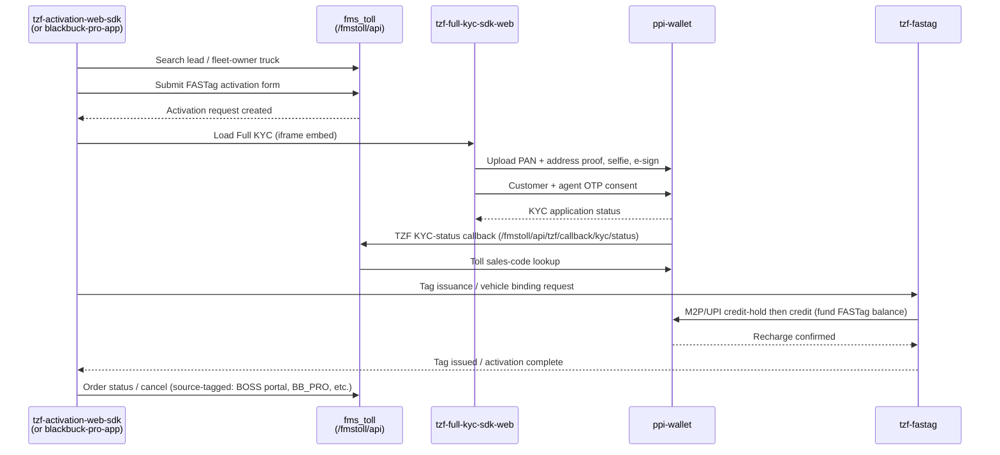

# FASTag onboarding and activation

Status note: this is a **draft** synthesized from static code evidence (API endpoint paths, config, Kafka topic names, package imports) across five repos — not from a PM walkthrough or a running trace. Re-verify against current code before citing exact request/response shapes in a PRD; the step boundaries and repo ownership are solid, the field-level detail underneath each step is not yet.

## Diagram

## Step-by-step narrative

- **Lead search + activation form submit** (Client → `fms_toll`)
    - `tzf-activation-web-sdk`'s `forms/screens/ftActivation/endpoints.ts` and `searchFleetOwnerTruck/endpoints.ts` call `/alchemist/fmstoll/api/*` directly.
    - `blackbuck-pro-app` does the same via `src/network/endpoints.js` (`addVehicleFastag: ${ENV.alchemistApi}/fmstoll/api/fastag-order/v2/initiate`), tagging requests with `source=BB_PRO` on at least one endpoint (`ftActivationFasTagCancelReason`) — `fms_toll`'s `FastagRequestService` appears to branch on a source/channel constant (`ApplicationConstants.BLACKBUCK_PORTAL_SOURCE` is one such value, seen in `BossPortalController`), i.e. `fms_toll` is a shared backend for at least two different client apps, not owned end-to-end by one.
    - Crosses the repo boundary here because the activation UI (web or agent app) and the FASTag lifecycle system of record (`fms_toll`) are separately owned/deployed.
    - `[permalink@?](https://github.com/BLACKBUCK-LABS/tzf-activation-web-sdk/blob/main/forms/screens/ftActivation/endpoints.ts) · verified 2026-08-27` — SHA not pinned yet (grabbed from a local clone, not a browsed permalink); re-resolve to a commit SHA before citing in a PRD.

- **Full KYC** (Client → `tzf-full-kyc-sdk-web` → `ppi-wallet`)
    - `tzf-activation-web-sdk` embeds `tzf-full-kyc-sdk-web` via iframe (`NEXT_PUBLIC_TZF_KYC_URL`, `config/index.ts`); `blackbuck-pro-app` embeds the same flow natively via `src/feature/tzf-full-kyc/TZFKYCView.tsx` inside a WebView.
    - Every one of `tzf-full-kyc-sdk-web`'s 15 API endpoints (`src/models/endpoints.ts`) is prefixed `/ppi-wallet/api/...` — document upload, personal details, customer + agent OTP, TSL review. This step crosses the boundary because identity verification (KYC) is centralized in `ppi-wallet` rather than duplicated per client.
    - `ppi-wallet`'s own `thoughts/product/2026-06-09.md` frames this explicitly as the "TZF Agent Flow" (Paper KYC), confirming intent on both sides.

- **KYC-status callback + toll sales-code lookup** (`ppi-wallet` ↔ `fms_toll`, bidirectional)
    - `ppi-wallet`'s `TollClientImpl.java` calls `fms_toll`'s `/fmstoll/api/kyc/request/sales-code/{requestId}` and `/fmstoll/api/tzf/callback/kyc/status`.
    - `fms_toll` has a matching `TzfPpiClientService.java` with a `PPI_WALLET_CLIENT` constant calling back into `ppi-wallet`.
    - A Kafka wire-contract event ("CRO selfie SMS") is also confirmed both-directions via matching test comments in each repo ("fms_toll resolves the CRO mobile + selfie link", "fms_toll's Gson DTO reads exactly these three keys").
    - Crosses the boundary because KYC ownership (`ppi-wallet`) and the Toll system of record (`fms_toll`) need each other's data mid-flow — not a one-way call.

- **Tag issuance + wallet funding** (Client → `tzf-fastag` → `ppi-wallet`)
    - `tzf-fastag` owns issuance/vehicle-binding (`controller/issuance`) and calls `ppi-wallet` (`services.ppi-wallet.base-url`, `PpiWalletClient.java`) for the M2P credit-hold-then-credit UPI flow that funds the FASTag balance.
    - Crosses the boundary because funding (wallet ledger, `ppi-wallet`) is separate from tag lifecycle (`tzf-fastag`).

- **Order status / cancellation** (Client → `fms_toll`, and/or a `/supplywrapper/boss/fastag/*` path)
    - Both `tzf-activation-web-sdk` (`ftActivationOrderStatus/endpoints.ts`) and `blackbuck-pro-app` (`endpoints.js` lines ~727-741) hit a `/supplywrapper/boss/fastag/*` path family for order status, cancel, replacement, and checkout — **not** `/fmstoll/api` directly for these specific calls. Whether `supplywrapper/boss` is a facade in front of `fms_toll` or a separate service is unconfirmed — flagged, not asserted.

## Open questions (carried from Pass 1, unresolved)

- Is `/alchemist/supplywrapper/boss/fastag/*` the same backend as `/alchemist/fmstoll/api/*`, or a distinct gateway/service sitting in front of (or beside) `fms_toll`? No single repo's code disambiguates this.
- Which portal (`TZF-portal` or `tzf-ops-portal`) actually consumes `tzf-fastag`'s `tzfPortal` package API surface — both are plausible; the `x-agent-identifier` header on the KYV portal-upload endpoint leans toward `tzf-ops-portal` (agent/ops tool) but isn't confirmed.
- No SHA-pinned permalinks yet — every code pointer above is a local-clone file path, not a browsed GitHub permalink. Re-resolve to `permalink@<short-sha>` URLs before treating this file as fully compliant with the code-pointer format in `SKILL.md`.
