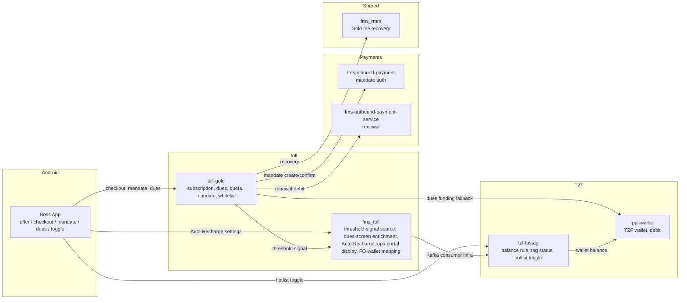

# Gold (ARP v2) subscription lifecycle

**Why this file exists.** Gold is a cross-repo capability, not a single service -- its subscription/dues/benefit logic lives in `toll-gold`, but several capabilities a PRD extending Gold needs to cover live in *other* repos entirely (Auto Recharge and ops-portal display both turned out to be `fms_toll`'s, not `tzf-fastag`'s or `tzf-ops-portal`'s, despite naming that would suggest otherwise). No single vertical file or a PM's own description reliably surfaces all of this, because a codebase doesn't announce its own scope -- something has to name a capability before the skill's grep discipline can verify it. This file is that something: a capability map, not a checklist of category names. **Read every row below for any PRD that extends Gold to a new vendor, a new tier, or a new benefit -- do not wait for the PM to name a row before checking it.** The row itself is the prompt.

## Diagram

## Capability map

Each row: what the mechanism is, exactly where it lives today (as built for IDFC/LivQuik, the two vendors Gold already supports), and what's actually true versus assumed for extending it to a third vendor or any new benefit.

| Capability | Where it lives today (IDFC/LivQuik, shipped) | What a vendor/benefit extension needs to check |
|---|---|---|
| **Whitelisting / phased rollout** | `toll-gold` `WhitelistController` -- `POST /whitelist/arp/v2/fo` (query params `fleet_owner_id`, `plan_ids`; empty-body 200 response, no confirmation id), `FleetOwnerArpPlanConfigService` | Validation is thinner than it looks: FO_ID existence is only checked on one of two admission code paths; mandate is correctly optional at whitelist time (captured later, §Activation). Duplicate-admission behavior is unverified since the response carries no body. |
| **Plan fetch / eligible plans** | `toll-gold` `GoldSubscriptionController.getArpV2PlansForFo(foId)` | Gated purely on whitelist membership -- no separate vendor check at fetch time. |
| **Activation (subscription creation)** | `toll-gold` `SubscriptionUtilityServiceImpl.checkEligibilityAndActivateZbppV2` | Non-idempotent write, no retry scheduler. A new paid subscription is born `ActivationStatus.OVERDUE`, not `ACTIVE` -- `ACTIVE` is only set later, on full payment. |
| **Mandate capture + Priority-Plus reuse** | `toll-gold` `TollMandate` lifecycle, `SubscriptionFeeService.createMandateIfNeeded`, `TollMandateDbService.getMaxMandateForFleetOwnerAndStatus` -- already selects the largest **confirmed mandate regardless of source** (PP or ARP) | Mechanism is already vendor-agnostic; no per-vendor work needed here. A known defect exists independent of any extension: the CTA guard in `createMandateIfNeeded` is a no-op (`if (!list.contains(...)) { log.info(...) }` with no `return`). |
| **Activation-time "benefit is on" signal** | `toll-gold` publishes `ThresholdChangeEvent{fleetOwnerId, source, validateToggle}` to `fms_toll.fastag_threshold_change_event`. Six emission sites exist, **all post-activation** (dues-clearance / full-payment / quota-freed paths) -- `checkEligibilityAndActivateZbppV2` itself emits no threshold signal at all. | This is the single most common defect when extending Gold to anything: a brand-new paying customer gets no benefit until they later clear a due, because nothing signals "Gold just turned on" at the moment it actually turns on. Check this FIRST for any new benefit that's supposed to apply "as soon as Gold activates." |
| **Threshold / credit-floor application** | IDFC/LivQuik: a synchronous threshold-change API changes the wallet threshold in place. | A vendor whose balance-check logic runs the negative-balance check *before* reading any threshold (e.g. `tzf-fastag`'s `BalanceRule.java`) makes a plain threshold push a no-op -- the rule itself needs a credit-floor concept, not just a lower threshold. Don't assume "push the threshold down" transfers mechanically to a new vendor; read that vendor's own balance-evaluation order first. |
| **Hotlist / de-hotlist (Gold-driven)** | `TopUpsService`'s hotlist fan-out is vendor-enumerated (`Arrays.asList(Vendor.IDFC, Vendor.LIVQ)`), and `hotlistTagOrWallet` builds a payload only for those two. | **Known dead code, independent of any extension**: `TzfFastagHotlistService` in `fms_toll` implements the shared `IFastagHotlistService` interface but leaves `retryHotlisting`, `retryDehotlisting`, `retryHotlistingSingular`, `retryDehotlistingForSingular`, `hotlistTagsForFo`, and `dehotlistFOTags` as **empty method bodies** -- any Gold-driven hotlist retry for that vendor is a silent no-op today, not a failure. Check whether this has been fixed before citing hotlist reliability as "same as other vendors." |
| **Dues attribution / swipe-to-due conversion** | Due amount is derived per vendor explicitly (IDFC uses the debit amount, LivQuik the transaction amount) -- there is no generic/default case. | A new vendor produces zero due rows and consumes zero quota until an explicit case is added; this fails silently, not loudly. |
| **Dues clearance (4 independently-triggered paths)** | (1) mandate presentation, (2) app-triggered global clearance (`globalDuesClearanceV2`, no mandate read), (3) automatic sweep from tag balance (`clearPendingDuesIfTagBalanceSufficient`), (4) nightly recovery job (`AutoRechargePlusScheduler.processingRecoveries`) -- terminal funding fallback is a `ppi-wallet`-style wallet debit. | All four paths are vendor-extensible in principle, but path 3 (`freeUpTopUpsWithLock`) `continue`s on any non-IDFC tag today -- check this per vendor. A wallet-debit fallback that pulls from a *different product's* wallet to settle Gold dues needs compliance sign-off -- this is not a code question. |
| **Pre-existing negative balance at Gold purchase** | Already fully handled: activation is rejected if the count of low-balance tags is at or above the plan's max-topups; otherwise a pending due row is written per negative tag, flagged as a consumed top-up, tagged with the vendor. | A new vendor just needs inclusion in the count and the vendor tag on its due rows -- the mechanism itself needs no new design. |
| **Mandate re-registration after revocation** | Restores the mandate-presentation route without re-running full checkout; Priority-Plus reuse applies here too. | Vendor-agnostic, no extension work needed. |
| **Lifecycle states** | Three coexisting concepts: `ConsentStatus` (the real gate -- every swipe-time check, the suspension cron's working-set query, and subscription lookups all key on this), `ActivationStatus` (bookkeeping, written in only 4 places, `INACTIVE` is **never** written by any code path), `derivedStatus` (a read-time display value, not persisted, not gateable by another service). | Gate any new logic on `ConsentStatus`, never `ActivationStatus` (a paid customer is born `OVERDUE` there, which would wrongly deny benefits to every new customer on day one) or `derivedStatus` (not queryable cross-service). Don't write `ActivationStatus.INACTIVE` -- it's dead code and adding a write to it creates a field with no reader. |
| **Tag & Wallet Closure** | **No customer-facing closure flow exists in `toll-gold`, `fms_toll`, or `tzf-fastag` for ANY vendor** -- only an ops-initiated path and a network force-closure callback, and neither touches Gold dues, thresholds, or subscription state at all. | This is a Gold-wide gap, not specific to any one vendor. Any PRD introducing or extending Gold for a vendor where customers can close tags/wallets needs to design this from scratch, including the sequencing hazard where Gold deactivation succeeds but the underlying network closure call fails afterward, leaving a customer with no subscription and an open tag. |
| **Auto Recharge interaction** | Auto Recharge itself lives in **`fms_toll`**, not `toll-gold` or `tzf-fastag` -- fully built, with retry and automatic mandate fallback. **It explicitly excludes Gold customers today** (guarded on `plan is not ARP v2`). | Auto Recharge and Gold are currently *mutually exclusive by design*, for every vendor, not just a new one. This must be resolved as a product decision (should AR pay down Gold dues when it fires, and if so how) before any Gold+AR interaction can be built for anyone. |
| **Deactivation & Reactivation** | No-refund-on-deactivation is how the code is already written. **No dues-clearance gate before deactivation, and no no-trial-on-reactivation rule, exist in code for any vendor** -- these are unbuilt product decisions, not facts a grep will ever surface. | Don't assume "deactivation already works the same everywhere" just because *a* deactivation code path exists -- the actual gating/reactivation rules are open product design for every vendor, current and new. |
| **Fee collection priority (across multiple funding sources)** | No explicit priority table, no excess-refund-on-double-collection rule, and no dedicated ledger line-item tag exist anywhere in code, for any vendor combination. | Net-new design work regardless of which vendor is in scope -- don't treat the existing dues-clearance waterfall (which resolves one funding attempt at a time) as equivalent to a stated cross-source priority order. |
| **Notifications** | Of the four natural lifecycle moments (whitelisting, top-up/quota exhaustion, renewal, deactivation), **only renewal (success and failure) is actually built**, with Gold-branded push copy. | Whitelisting, top-up-exhaustion, and deactivation notifications don't exist for any vendor today -- don't assume "the others must exist somewhere" without checking; they were verified absent by direct search. |
| **Plans, value proposition & applicability** | **The Gold whitelist has no vendor dimension at all.** The moment a new vendor becomes a recognized Gold vendor in the eligibility/whitelist logic, every *existing* Gold FO who happens to also hold a tag of that new vendor is swept into Gold for it automatically and silently -- no bug required, just the natural consequence of adding a value to an enum-like check that was never vendor-scoped. | **Check this first, before any other row**, for any PRD that adds Gold to a new vendor. It is the highest-blast-radius finding in this whole map: it silently changes behavior for FOs who are not the PRD's stated audience. |
| **Ops portal support** | Whatever field/screen shows which vendor's Gold plan an FO is on is **`fms_toll`'s surface, not `tzf-ops-portal`'s** (despite the latter being the natural-sounding place to look for a TZF-facing ops feature). | Downstream of the missing vendor dimension above -- don't scope this work to the vendor's own ops portal without first confirming which repo actually owns the screen. |
| **Known reliability quirks worth carrying over deliberately** | Replacement-tag fee waiver for Gold-active-or-overdue customers is correctly vendor-agnostic already and needs no change. The customer's truck-level hotlist toggle is **not** forced ON when Gold first activates -- a customer can pay and get zero benefit if they never separately flip it, and this is worse for a vendor whose own toggle rule outranks the balance rule. Auto/manual hotlist compatibility already holds structurally via a rule-priority engine (`TagStatusPriority`) -- no new compatibility rule needed, just a recognizable, structured hotlist-reason code (today it's free text). | Re-verify each of these three specifically rather than assuming "reliability fixes elsewhere in Gold automatically apply" -- two of the three transfer cleanly, one (the toggle-forced-ON gap) gets *worse* for a vendor whose own status rules can override the balance rule. |

## Open questions (carried forward, unresolved as of last verification)

- Should Auto Recharge be allowed to pay down Gold dues at all, and if so which of the two systems (`toll-gold`'s dues-clearance waterfall or `fms_toll`'s Auto Recharge) should own that interaction going forward?
- What should the cross-source fee-collection priority order actually be once more than two funding sources exist for one FO (own-bank wallet, mandate, and more than one partner-tag/wallet)?
- Is the "sweep every existing Gold FO's tags of the new vendor into Gold automatically" behavior ever acceptable, or does every vendor addition need an explicit opt-in/re-confirmation step per FO?
- Does the empty-method-body hotlist retry gap in `TzfFastagHotlistService` (`fms_toll`) get fixed as part of a vendor-extension PRD, or does it need its own standalone bug-fix track regardless?

## Note on how this file came to exist

The first attempt at extending Gold to TZF (a real PRD, drafted 2026-09-07) covered whitelisting, activation, mandate mechanics, dues attribution, dues clearance, mandate re-registration, lifecycle states, the hotlist toggle, subscription cycles, and outbound renewal -- accurately and well-cited. It did **not** cover Tag & Wallet Closure, Auto Recharge, Deactivation & Reactivation as a process, Fee Collection Priority, Notifications, Plans/Value-Prop/Applicability, Ops Portal support, or three known reliability quirks -- not because the drafting model couldn't verify them (once told to check, every one of the 8 came back with accurate, cited findings, including two genuinely load-bearing discoveries: the dead hotlist-retry code and the Auto-Recharge/Gold exclusion), but because nothing in the skill's process at the time prompted it to go looking. This file exists so the next PRD that touches Gold doesn't depend on a PM (or a comparison against an old hand-written spec) to name these rows one at a time again.
